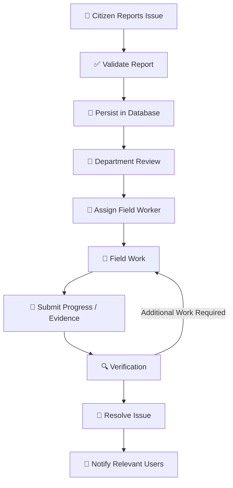

 <div align="center">

# 🏙️ CIVIORA

### AI-Powered Civic Intelligence & Urban Resilience Platform

**Understand the city. Respond intelligently.**

[](https://civioraai.vercel.app/)

[](https://react.dev/)
[](https://www.typescriptlang.org/)
[](https://threejs.org/)
[](https://nodejs.org/)
[](https://expressjs.com/)
[](https://fastapi.tiangolo.com/)
[](https://www.mongodb.com/)
[](https://www.docker.com/)

[🌐 Live Demo](https://civioraai.vercel.app/) · [✨ Features](#-platform-capabilities) · [🏗️ Architecture](#-system-architecture) · [🧠 AI Models](#-ai--machine-learning) · [🚀 Setup](#-local-development-setup)

</div>

---

## 🌆 1. Project Overview

**Civiora** is an AI-assisted civic intelligence and urban-response platform designed to connect citizens, municipal departments, administrators, and field workers through a unified issue-management workflow.

Traditional civic reporting processes can involve fragmented communication, delayed assignments, limited progress visibility, and difficulty tracking an issue from submission to resolution.

Civiora aims to improve this process by combining **full-stack web development, geospatial context, role-based workflows, AI-assisted analysis, and operational monitoring** in one platform.

### 🎯 Project Objectives

- 📍 Simplify civic issue reporting with location-aware submissions.
- 🗺️ Provide geographical context for reported incidents.
- 👥 Enable role-based access for citizens, officers, managers, and field workers.
- 🔄 Track issues through assignment, field work, verification, and resolution.
- 🤖 Explore AI-assisted hazard classification and duplicate-report detection.
- ⏱️ Support prioritisation, service-level monitoring, and escalation workflows.
- 🔔 Improve communication through notifications and status updates.
- 🔐 Maintain secure access, validated data, and traceable operations.
- 📱 Deliver a responsive experience across desktop and mobile browsers.

### 💡 Core Idea

> Transform civic reporting from a disconnected ticketing process into a transparent, location-aware, and intelligence-assisted urban-response workflow.

---

## ✨ 2. Platform Capabilities

<table>
<tr>
<td width="50%" valign="top">

### 🗺️ Smart Civic Reporting

- Submit civic issues with descriptions and categories.
- Associate reports with geographical locations.
- Support evidence uploads where implemented.
- Track report status and permitted report details.
- Provide a structured reporting workflow.

</td>
<td width="50%" valign="top">

### 👥 Role-Based Operations

- Citizen reporting and tracking.
- Department-level triage and assignment.
- Field-worker task management.
- Managerial monitoring and verification.
- Administrative controls based on permissions.

</td>
</tr>
<tr>
<td width="50%" valign="top">

### 🤖 AI-Assisted Intelligence

- Image-based hazard classification.
- Object detection and image segmentation.
- NLP-based report analysis.
- Semantic similarity for duplicate suggestions.
- Risk-based prioritisation support.

</td>
<td width="50%" valign="top">

### 📡 Operational Monitoring

- Report status dashboards.
- Work progress tracking.
- SLA monitoring and escalation concepts.
- Notifications and resolution reports.
- Real-time updates where configured.

</td>
</tr>
<tr>
<td width="50%" valign="top">

### 🌐 Geospatial Intelligence

- Location-aware issue management.
- Map-based incident visualisation.
- Nearby-incident analysis.
- Geospatial search concepts.
- Location-based prioritisation.

</td>
<td width="50%" valign="top">

### 🏙️ 3D Urban Visualisation

- Three.js-based visualisation.
- React Three Fiber integration.
- Digital-twin-style urban views.
- Incident markers and spatial context.
- Interactive visual exploration where connected to live data.

</td>
</tr>
</table>

> **Implementation transparency:** The feature list describes Civiora's project design and intended capabilities. Verify each feature in the running application before presenting it as fully implemented.

---

## 👤 3. User Roles and Responsibilities

| Role | Responsibilities |
|---|---|
| 🧑 Citizen | Submit civic issues, provide details, and track authorised reports. |
| 🦺 Field Worker | View assigned tasks, record progress, and submit completion evidence where supported. |
| 🏢 Department Officer | Review, triage, and assign issues according to permissions. |
| 📊 Department Manager | Monitor operational progress, priorities, and escalations where implemented. |
| 🚨 Emergency Operator | Handle emergency workflows if enabled. |
| 🛡️ System Administrator | Manage authorised platform configuration, users, and operational oversight. |

### 🔄 Typical Issue Lifecycle



The exact status names and allowed transitions must match the backend implementation. The server should validate each transition and record authoritative timestamps.

---

## 🏗️ 4. System Architecture

Civiora is designed around a modular architecture that separates the user interface, backend business logic, persistent storage, and AI-related processing.

```text
┌─────────────────────────────────────────────────────────────┐
│                       WEB FRONTEND                           │
│                                                             │
│      React 18 · TypeScript · Vite · Responsive UI           │
│      Three.js · React Three Fiber · Map Integration         │
└────────────────────────────┬────────────────────────────────┘
                             │
                       HTTPS / REST
                     WebSocket if enabled
                             │
                             ▼
┌─────────────────────────────────────────────────────────────┐
│                       BACKEND API                            │
│                                                             │
│                 Node.js · Express · TypeScript               │
│                                                             │
│    Authentication · Authorisation · Validation              │
│    Report Management · Assignment · Workflow                │
│    Notifications · Document Operations                      │
└──────────────────┬─────────────────────┬────────────────────┘
                   │                     │
                   ▼                     ▼
┌────────────────────────────┐ ┌──────────────────────────────┐
│       DATA SERVICES        │ │       AI MICROSERVICE        │
│                            │ │                              │
│ MongoDB · Mongoose         │ │ Python · FastAPI             │
│ Redis · BullMQ if enabled  │ │ Computer Vision if enabled   │
│ Geospatial indexes         │ │ NLP / Similarity if enabled  │
└────────────────────────────┘ └──────────────────────────────┘
```

### 🧰 Technology Stack

| Layer | Technologies | Purpose |
|---|---|---|
| Frontend | React, TypeScript, Vite | User interface and interactive application |
| 3D Visualisation | Three.js, React Three Fiber | Interactive 3D scenes and spatial visualisation |
| Backend | Node.js, Express, TypeScript | APIs, business logic, validation, and permissions |
| Database | MongoDB, Mongoose | Persistent application data |
| AI Service | Python, FastAPI | Model inference and AI endpoints when integrated |
| Real-Time Communication | Socket.IO / WebSocket | Live updates where enabled |
| Queue and Cache | Redis, BullMQ | Background jobs and retries where enabled |
| Geospatial Services | MongoDB geospatial queries, map provider | Location search and map display |
| Deployment | Vercel, backend hosting, Docker | Application hosting and deployment |

*Optional components must be verified against the actual repository and deployment.*

---

## 🧠 5. AI & Machine Learning

Civiora's AI layer can support report analysis, visual hazard recognition, similarity detection, and prioritisation.

### 🔬 Models and Techniques

| Model / Technique | Explanation | Potential application |
|---|---|---|
| **YOLO-family Object Detection** | Detects objects and predicts their classes and bounding boxes. | Identifying supported visible hazards such as road damage or waste. |
| **Image Segmentation** | Labels pixels or outlines regions of interest. | Identifying the visible extent of damage or pollution. |
| **Transformer-Based NLP** | Analyses contextual relationships in text. | Report intent classification, entity extraction, and urgency analysis. |
| **Sentence-BERT (SBERT)** | Converts text into semantic embeddings. | Finding reports with similar meanings. |
| **Haversine Distance** | Calculates approximate great-circle distance between coordinates. | Identifying geographically nearby reports. |
| **Risk Scoring** | Combines defined risk factors into a score. | Supporting issue prioritisation. |
| **SLA Monitoring / Forecasting** | Tracks or estimates performance against service targets. | Flagging reports that may miss deadlines. |

### ⚙️ AI Processing Pipeline

```text
Citizen Report
      │
      ├──────── Image Evidence
      │                │
      │                ▼
      │        Computer Vision
      │
      ├──────── Text Description
      │                │
      │                ▼
      │          NLP Analysis
      │
      └──────── Location
                       │
                       ▼
              Geospatial Analysis
                       │
                       ▼
           Similarity / Risk Analysis
                       │
                       ▼
             Reviewable Suggestions
                       │
                       ▼
           Authorised Human Decision
```

### 🛡️ Responsible AI

- Treat model predictions as suggestions rather than guaranteed facts.
- Map predicted categories to the backend's allowed category values.
- Handle unknown categories safely.
- Support human review for uncertain or safety-sensitive cases.
- Evaluate false positives and false negatives using representative data.
- Avoid claiming a model is trained or deployed unless its weights, inference service, and application integration are verified.

---

## 🔌 6. REST API Design

The backend can expose REST endpoints for report management and operational workflows.

| HTTP Method | Purpose | Illustrative route |
|---|---|---|
| `GET` | Retrieve reports or details | `/api/reports` |
| `POST` | Create a report | `/api/reports` |
| `GET` | Retrieve one report | `/api/reports/:id` |
| `PATCH` | Update permitted fields or status | `/api/reports/:id/status` |
| `DELETE` | Delete a resource when authorised | `/api/reports/:id` |

### Example JSON Response

```json
{
  "success": true,
  "data": {
    "id": "example-report-id",
    "status": "submitted"
  }
}
```

### API Engineering Principles

- Validate request data on the server.
- Return appropriate HTTP status codes.
- Authenticate protected requests.
- Enforce authorisation for every protected operation.
- Scope queries by ownership or tenant where applicable.
- Use pagination for large result sets.
- Keep secrets and stack traces out of error responses.
- Document actual endpoints and schemas.

The endpoint names and response format above are examples and should be aligned with the real API.

---

## 🗄️ 7. Database Design

MongoDB is a document-oriented database suitable for storing structured application records.

### Logical Data Model

| Collection | Example fields | Purpose |
|---|---|---|
| `users` | `name`, `email`, `role`, `tenantId` | User identity and permissions |
| `reports` | `category`, `description`, `location`, `status`, `reporterId`, `assigneeId` | Civic issue records |
| `workSessions` / `updates` | `reportId`, `workerId`, `startedAt`, `completedAt` | Field-work history |
| `auditEvents` | `actorId`, `action`, `reportId`, `timestamp` | Significant event history |
| `notifications` | `recipient`, `eventId`, `status`, `attempts` | Notification tracking |

The collections and fields above are illustrative; use the actual schema when documenting the implementation.

### Database Concepts

- **CRUD:** Create, Read, Update, Delete.
- **Schema validation:** Reject invalid or incomplete data.
- **Indexing:** Improve query performance for commonly accessed fields.
- **Geospatial indexing:** Support location-based queries.
- **References:** Connect related documents through identifiers.
- **Data integrity:** Keep categories, statuses, and relationships valid.
- **Audit history:** Preserve significant changes when required.
- **UTC timestamps:** Store authoritative times consistently and format them for display.

---

## 🔐 8. Security & Access Control

Civiora should enforce security through the backend, database configuration, and deployment environment.

### Security Principles

- 🔑 **Password Security:** Use a modern password-hashing algorithm such as Argon2id if configured.
- 🎟️ **Authentication:** Validate sessions or tokens, expiry, and refresh behaviour.
- 🛡️ **RBAC / ABAC:** Enforce role-based and attribute-based permissions.
- 🏢 **Tenant Isolation:** Restrict access to the correct tenant where applicable.
- 🧾 **Input Validation:** Validate categories, statuses, strings, files, and request parameters.
- 🔒 **Secret Management:** Keep API keys and credentials in environment variables or a secret manager.
- 🚦 **Rate Limiting:** Protect authentication and abuse-prone endpoints.
- 📁 **Secure File Access:** Validate uploads and check permissions before downloads.
- 🕵️ **Auditability:** Record important actions without logging passwords or tokens.
- 🔔 **Reliable Notifications:** Track pending, accepted, delivered when confirmed, and failed outcomes.

> **Important:** Demo credentials should be restricted to local development. Never publish production secrets or deploy shared default passwords.

---

## 🚀 9. Local Development Setup

### Prerequisites

- Node.js 20 or later
- npm 10 or later
- Python 3.10 or later for the AI service
- Git
- Docker and Docker Compose if required by the local setup

### Step 1 — Clone the Repository

Replace the placeholders with the actual repository URL and directory name.

```bash
git clone <YOUR_REPOSITORY_URL>
cd <YOUR_REPOSITORY_DIRECTORY>
npm install
```

### Step 2 — Configure Environment Variables

If the following template files exist:

```bash
cp .env.example .env
cp apps/backend/.env.example apps/backend/.env
cp apps/ai-service/.env.example apps/ai-service/.env
```

Example configuration names:

```dotenv
NODE_ENV=development
PORT=4000
MONGODB_URI=
REDIS_URL=
JWT_SECRET=
AI_SERVICE_URL=http://localhost:8000
```

These names are illustrative. Match them to the actual configuration used by your application.

**Never commit production credentials to GitHub.**

### Step 3 — Start Local Services

If the repository contains the specified Docker Compose configuration:

```bash
docker compose -f docker/docker-compose.yml up -d
```

### Step 4 — Seed Development Data

If the backend workspace contains a seed script:

```bash
npm run seed --workspace=apps/backend
```

Use development data only and verify the seed script cannot overwrite production records.

### Step 5 — Start the Application

Run the scripts configured in your actual `package.json`:

```bash
npm run dev:web
npm run dev:backend
npm run dev:ai
```

Example local URLs, depending on configuration:

| Service | URL |
|---|---|
| Web Frontend | `http://localhost:5173` |
| Backend API | `http://localhost:4000` |
| AI Service | `http://localhost:8000` |

---

## 🧪 10. Build & Testing

If configured in the project:

```bash
npm run typecheck
npm run build
```

### Verification Checklist

- [ ] Frontend loads on desktop and mobile browser sizes.
- [ ] Login and role-based access work correctly.
- [ ] Report creation persists data in the database.
- [ ] Assignment and field-work actions follow valid status transitions.
- [ ] Location permission failures are handled gracefully.
- [ ] Downloads have the correct content and file extension.
- [ ] Email failures are logged and do not erase saved reports.
- [ ] API validation and permission checks are tested.
- [ ] AI category mappings and uncertain predictions are handled safely.
- [ ] Production environment variables and backend connectivity are verified.

A successful build does not prove every integration works. Test the complete workflow in the environment used for the demonstration.

---

## ☁️ 11. Live Deployment

<div align="center">

### 🌐 Experience Civiora

[](https://civioraai.vercel.app/)

**Live URL:** https://civioraai.vercel.app/

</div>

### Deployment Checklist

1. Deploy the frontend to Vercel or the selected web host.
2. Deploy the backend API to a compatible server.
3. Configure the production API base URL in the frontend.
4. Set database, authentication, AI, and notification secrets securely.
5. Configure CORS for the intended frontend origin.
6. Configure health checks and inspect service logs.
7. Test login, report creation, persistence, assignment, and downloads.
8. Verify AI and real-time services if the application depends on them.
9. Confirm all public links point to the intended production services.

A deployed frontend does not by itself prove that every backend, AI, queue, WebSocket, or mobile component is deployed.

---

## 📂 12. Repository Structure

The following is a suggested layout. Update it to reflect the actual repository.

```text
civiora/
├── apps/
│   ├── web/              # React + TypeScript + Vite frontend
│   ├── backend/          # Node.js + Express API
│   ├── ai-service/       # Python + FastAPI, if present
│   └── mobile/           # Flutter application, if present
├── packages/
│   └── shared/           # Shared types and validation, if present
├── docker/               # Docker and Compose configuration, if present
├── docs/
│   ├── ARCHITECTURE.md
│   ├── API.md
│   ├── SECURITY.md
│   └── DEPLOYMENT.md
├── package.json
└── README.md
```

---

## 🛣️ 13. Development Roadmap

- [ ] Document and verify production API endpoints.
- [ ] Complete end-to-end tests for reporting through resolution.
- [ ] Evaluate AI performance on representative data.
- [ ] Improve duplicate-report detection and false-match handling.
- [ ] Add notification delivery monitoring and safe retries.
- [ ] Improve accessibility and mobile-browser usability.
- [ ] Document deployment and recovery procedures.
- [ ] Keep architecture diagrams aligned with the running implementation.

Only mark items complete after implementation and testing.

---

## 🤝 14. Contributing

Contributions and improvements should follow a clear development process.

1. Create a feature branch.
2. Implement a focused change.
3. Add or update relevant tests.
4. Run the configured typecheck and build commands.
5. Document API, schema, and configuration changes.
6. Submit a pull request with a clear summary.

Never include credentials or sensitive production data in public issues or commits.

---

## 📜 15. License

The project brief specifies the **MIT License**. Ensure the repository contains a valid `LICENSE` file matching the intended licence before publishing.

---

<div align="center">

### 🏙️ Better Reporting. Smarter Response. More Accountable Cities.

**[🌐 Launch Civiora](https://civioraai.vercel.app/)**

*Full-stack engineering · Geospatial intelligence · Responsible AI*

</div>
